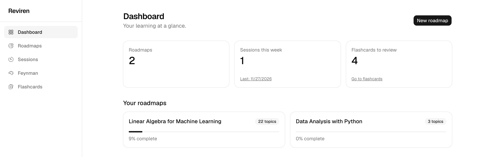
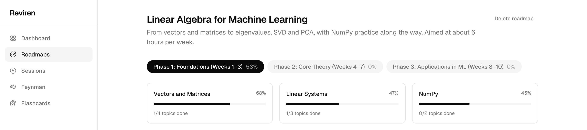
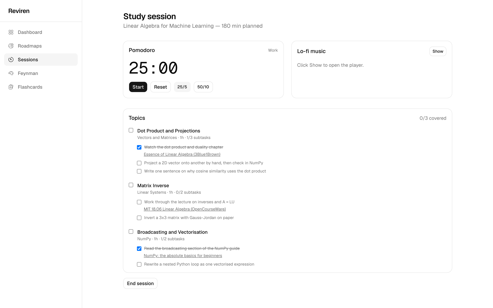
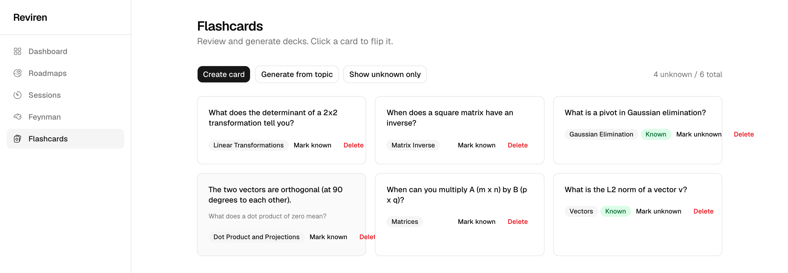

# Reviren

A study planner that turns a topic into a learning roadmap and helps you work through it session by session.

> **Status:** on hold for now. Later I plan to pivot this project in a new direction and then finish it.

## Why

When you teach yourself a subject, you need a plan, time to study, and a way to check that you understood it. Most tools cover only one of these. Notion is a blank page. Anki only does flashcards. Online courses have a fixed path. Reviren puts the roadmap, the study sessions, progress tracking and self-testing in one app.



## Features

- **Roadmap generation.** Type a topic. The app asks you 3–5 short questions about your goal, what you already know and how much time you have. Then an AI agent searches the web and builds a roadmap: phases, sections, topics and a free learning resource for each topic. You see a preview and save it.
- **Roadmap import.** Paste an existing roadmap or upload a `.pdf`, `.md` or `.txt` file. Claude turns it into the same structure.
- **Roadmap view.** Phases appear as tabs. Each section shows its progress, and each topic has a progress bar from 0 to 100%. You can add or delete topics and delete a roadmap.
- **Session planning.** Pick a roadmap and how many hours you have.
  - *AI mode:* Claude picks topics, mixing sections and putting low-progress topics first. It gives at least one hour per topic and splits each topic into subtasks with links.
  - *Manual mode:* tick the topics yourself.
- **Study session.** A checklist of topics and subtasks, a Pomodoro timer (25/5 or 50/10) and an optional lo-fi YouTube player.
- **End of session.** Claude suggests how much progress you made on each topic. You can change the numbers before saving. Progress adds up to section and phase level.
- **Feynman review.** Pick a topic and explain it in your own words. Claude gives a score from 1 to 10, says what was solid and what was missing, and lists topics to revisit. Reviews are saved. There is no page to browse old reviews yet.
- **Flashcards.** Write cards yourself or generate them from a topic with Gemini. Flip cards, mark them known or unknown, and show only unknown cards.
- **Dashboard.** Roadmap progress, sessions this week, and how many flashcards are left to review.

| Roadmap | Study session | Flashcards |
| --- | --- | --- |
|  |  |  |

The screenshots show demo data.

## How the roadmap agent works

The agent is a LangGraph.js graph with four steps. First it searches the web (Tavily) for curricula on your topic. Then Claude turns the results into phases, sections and topics, using your answers to the opening questions. For each section it searches for free resources. Paid course platforms are excluded, and Reddit is used as a fallback for niche topics. It reads the top pages, and Claude picks one main source and rates how well it covers each topic. Topics covered less than 90% get their own search. The result is checked with Zod, and each step streams to the UI as it runs.

Code: [`src/lib/agent/roadmap-agent.ts`](src/lib/agent/roadmap-agent.ts)

## Tech stack

- Next.js 16 (App Router, Server Actions), React 19, TypeScript
- Tailwind CSS v4, shadcn/ui
- LangGraph.js and LangChain
- Claude Sonnet 4.6: roadmap agent, import, session planning, progress, Feynman scoring
- Claude Haiku 4.5: the questions asked before a roadmap is generated
- Gemini 3.5 Flash: flashcard generation
- Tavily: web search for the agent
- PostgreSQL (hosted on Supabase) with Drizzle ORM and drizzle-kit migrations
- Zod for structured LLM output
- Vitest

## Run locally

You need Node.js 20.9 or newer, pnpm, and a PostgreSQL database.

### 1. Install

```bash
git clone https://github.com/liteee69/Reviren.git
cd Reviren
pnpm install
```

### 2. Environment variables

Copy the example file and fill in your values:

```bash
cp .env.example .env.local
```

Both Next.js and `drizzle-kit` read `.env.local`.

| Variable | Needed for |
| --- | --- |
| `DATABASE_URL` | Everything. The app connects with SSL, so the database must accept SSL connections (Supabase does). |
| `ANTHROPIC_API_KEY` | All AI features except flashcard generation. |
| `GOOGLE_GENAI_API_KEY` | Flashcard generation. |
| `TAVILY_API_KEY` | Roadmap generation (web search). |

All three AI models are created in one module ([`src/lib/ai.ts`](src/lib/ai.ts)). So any AI feature, and `pnpm build`, needs both the Anthropic and the Google key to be set. Without keys you can still run `pnpm dev` and use the parts that only touch the database: browse and edit roadmaps, plan sessions manually, run a session and use flashcards you write yourself.

### 3. Database

The database is plain PostgreSQL. Supabase Auth and the Supabase client are not used. To create the tables, run:

```bash
pnpm exec drizzle-kit migrate
```

The last migration removes access for Supabase's `anon` and `authenticated` roles, so only the server can read the data. On plain PostgreSQL (not Supabase), create those roles first:

```sql
CREATE ROLE anon NOLOGIN;
CREATE ROLE authenticated NOLOGIN;
```

Optional: load fake demo data (the data shown in the screenshots) into the empty database:

```bash
psql "<your DATABASE_URL>" -f docs/seed-demo.sql
```

### 4. Start

```bash
pnpm dev
```

Open http://localhost:3000.

### Tests

```bash
pnpm test
```

## Notes

- Single user, no login. Anyone who can open the app can see and change all the data, so do not deploy it publicly as it is.
- AI calls use your own API keys and cost money. Generating one roadmap takes many search and model calls.

## About

I built Reviren on my own as a learning project, with Claude Code as a coding assistant. I wanted to learn LangGraph and build a study tool I would use myself.

## License

MIT. See [LICENSE](LICENSE).
